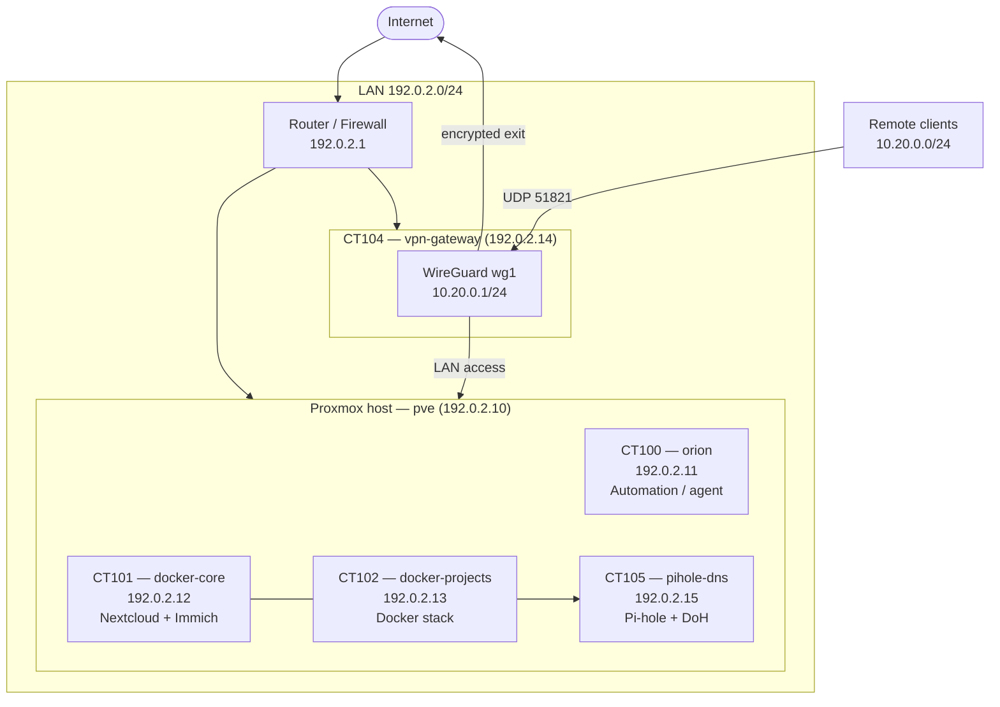

# Homelab

A self-hosted infrastructure lab built around a single low-power mini PC running Proxmox VE. It hosts a mix of self-hosted services (files, photos, media, automation), a segmented network with an encrypted DNS resolver, a WireGuard VPN gateway for remote access, and scheduled backups to two independent disks.

The goal is simple: own the data, keep services isolated, and make the whole environment recoverable from scratch using documented steps.

> All addresses, domains, hostnames, and identifiers in this repository are **placeholders**. See [docs/network.md](docs/network.md) for the addressing convention.

---

## Hardware

| Component | Spec |
|---|---|
| Host | Mini PC, low-power x86-64 (Celeron N5095A class) |
| CPU | 4 cores |
| RAM | 16 GB |
| OS disk | ~476 GB NVMe |
| Secondary disk | ~320 GB HDD |
| Storage pool | 2× ~1.8 TB HDD in a ZFS mirror (`tank`) |
| External disk | ~1 TB (RAID-1TB, single-disk mount) |

No serial numbers or unique hardware identifiers are published.

## Software Stack

| Layer | Technology |
|---|---|
| Hypervisor | Proxmox VE 9.x |
| Containerization | LXC containers + Docker (Compose) |
| Host OS (containers) | Debian-based |
| Files & sync | Nextcloud (MariaDB + Redis) |
| Photos | Immich (PostgreSQL + Redis/Valkey + ML) |
| Media | Jellyfin |
| Automation | n8n |
| DNS | Pi-hole with DNS-over-HTTPS upstream |
| Remote access | WireGuard (self-hosted gateway) |
| Backups | Proxmox `vzdump` + Backrest (restic) |
| Monitoring | Prometheus, Grafana, Uptime-Kuma, cAdvisor, Node Exporter, Blackbox Exporter |
| Dashboards | Homepage |

## Architecture Diagram

Rendered Mermaid sources live in [`diagrams/`](diagrams/).

## Demonstrated Skills

- **Linux administration** — systemd services, cron, journald tuning, OOM protection (`earlyoom`).
- **Virtualization** — Proxmox VE, LXC lifecycle, resource allocation, bind mounts, boot ordering.
- **Storage** — LVM-thin, ZFS mirror, independent backup disks, mount/`fstab` recovery.
- **Docker & Compose** — multi-service stacks, network isolation (`network_mode`), version pinning.
- **Networking** — subnet segmentation, static routing, NAT/masquerade, `socat` port forwarding, DynDNS.
- **VPN** — WireGuard server + peers, kill-switch rules, split vs. full tunnel.
- **DNS & privacy** — Pi-hole, DNS-over-HTTPS resolver, blocking modes.
- **Backup & recovery** — snapshot schedules, restic repositories, restore procedures.
- **Monitoring** — metrics collection, dashboards, uptime checks, alerting.
- **Security** — key-based SSH, firewall, least privilege, secret separation.

## Reproducing the Setup (High Level)

1. Install **Proxmox VE** on the host; set hostname and management IP.
2. Create storage: LVM-thin for container disks, import/create the ZFS mirror.
3. Create LXC containers (see [docs/architecture.md](docs/architecture.md)) and assign IPs.
4. Add persistent mounts (`fstab` / systemd) for the data disks.
5. Deploy container stacks with Docker Compose (see `compose/`).
6. Configure Pi-hole as the LAN DNS server and point DHCP at it.
7. Deploy the WireGuard gateway and generate client peers.
8. Configure host services: port forwarding, DynDNS, backup jobs.
9. Set up monitoring and verify dashboards.
10. Validate backups by performing a test restore.

Full recovery order is documented in [docs/backup-and-recovery.md](docs/backup-and-recovery.md).

## Problems Solved

- Loopback DNAT did not work on the host kernel — replaced with a `socat` port-forwarding service.
- Pi-hole running alongside a busy Docker host was taken down by restarts — moved it to a dedicated container.
- A container could not read the Pi-hole database due to unprivileged UID mapping — resolved by running it privileged.
- `CAP_SYS_RAWIO` is blocked inside LXC — disk SMART tooling had to run on the host.
- Dynamic public IP broke VPN clients — resolved using provider DynDNS.

More detail in [docs/lessons-learned.md](docs/lessons-learned.md).

## Planned Improvements

- TODO: Add automated configuration management (Ansible) for reproducibility.
- TODO: Centralize logs across containers.
- TODO: Add full-disk encryption / encrypted backup repository.
- TODO: Add infrastructure-as-code for the Proxmox layer.
- TODO: Add off-site backup copy.

---

*Documentation is maintained manually. Nothing here is auto-generated from live systems.*
