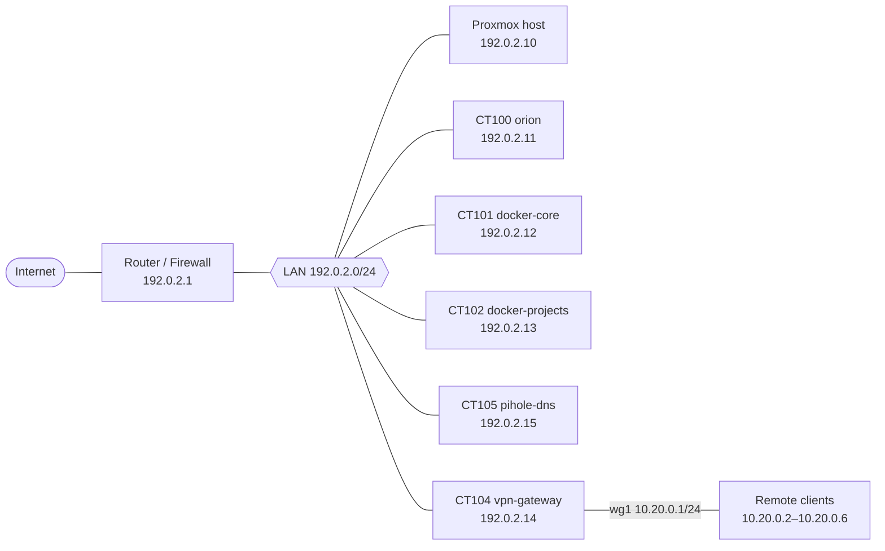

# Network

## Addressing Convention

All addresses in this repository are placeholders:

| Range | Use |
|---|---|
| `192.0.2.0/24` | Main LAN (RFC 5737 documentation range) |
| `198.51.100.0/24` | Secondary segment (VPN clients) |
| `10.20.0.0/24` | WireGuard tunnel network (RFC 1918) |
| `example.com` | Public domain |
| `vpn.example.com` | Dynamic DNS hostname |

## Topology

## Segments

| Segment | Subnet | Purpose |
|---|---|---|
| Main LAN | `192.0.2.0/24` | Host, containers, physical devices |
| VPN client segment | `198.51.100.0/24` | Devices routed through the VPN gateway |
| WireGuard tunnel | `10.20.0.0/24` | Encrypted tunnels to remote clients |

- Addresses on the VPN client segment are **static** (no DHCP); gateway and DNS are set manually per device.
- The VPN gateway has two interfaces: one on the main LAN, one on the client segment.

## DNS

| Item | Value |
|---|---|
| Resolver | Pi-hole (CT105, `192.0.2.15`) |
| Upstream | DNS-over-HTTPS resolver on `127.0.0.1:5053` |
| DHCP advertisement | Router points clients to the Pi-hole address |
| Blocking mode | `NX` |

- DNS-over-HTTPS hides upstream queries from the ISP.
- The DoH resolver image is **pinned**; the `latest` tag lacks the proxy mode used here.

## Routing and NAT

- Static return routes are added on the host and containers so LAN hosts can reach VPN clients:
  - Host: routes for `10.20.0.0/24` and the client segment via the VPN gateway.
  - DNS container: same routes, reapplied by a cron job (every minute + on boot).
- The router has a static route for the VPN client segment pointing at the VPN gateway.
- NAT/masquerade rules translate VPN client traffic to the LAN and to the upstream tunnel.

## Firewall

- The VPN gateway applies an `nftables` kill-switch: client traffic is dropped unless it exits through the intended interface.
- Traffic from VPN clients to the LAN is explicitly allowed; everything else is dropped by default.

## Remote Access

| Item | Value |
|---|---|
| Protocol | WireGuard (UDP) |
| Listen port | `51821` |
| Endpoint | `vpn.example.com:51821` (dynamic DNS) |
| Mode | Full tunnel (`0.0.0.0/0`) |
| MTU | 1380 |
| DNS pushed | Pi-hole address |

- The public IP is **dynamic**; a provider dynamic-DNS hostname is always used in client configs so tunnels survive IP changes.
- Clients: phone, laptop (Linux), iPhone.

TODO: confirm whether any service is published via the outbound tunnel and list public hostnames (currently omitted).

## Placeholders Used

- LAN/host/container IPs → `192.0.2.x`
- VPN client segment → `198.51.100.x` / `10.20.0.x`
- DynDNS hostname → `vpn.example.com`
- Private domain → `example.com`
